# Underwater ROV: Mechanical Design Lead

**Mechanical R&D Lead (Co-op) · Underwater robotics startup · May – Aug 2026**

I led the mechanical design of a startup's first remotely operated underwater vehicle (ROV)
prototype, from hand sketches through CAD, simulation, fabrication and pool testing. The
structural design I set became the baseline that the follow-on team carried into later build cycles.

  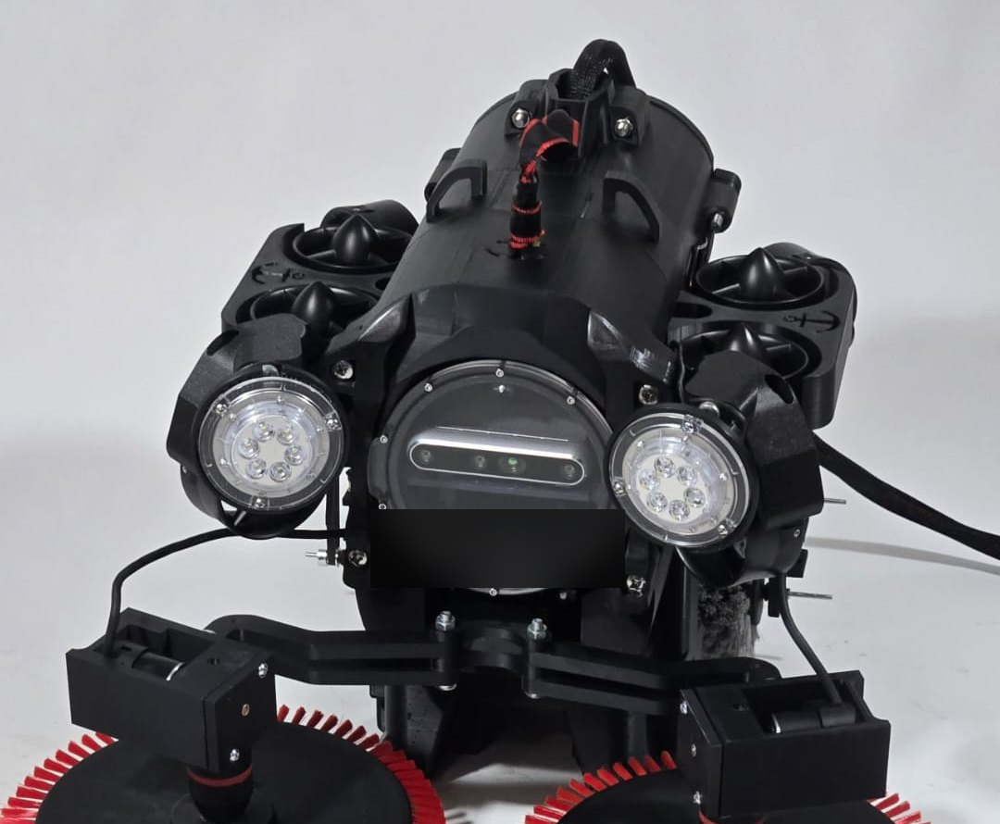

> Shared with the company's permission. CAD files, proprietary subsystems and company details
> are intentionally left out, so this page covers the general ROV platform only.

## My role

- **Led the mechanical design** of the V1 vehicle from concept through fabrication
- **Directed a 3-person mechanical team** (2 engineers plus a faculty advisor) and released **30+ structural components and subassemblies** in SolidWorks and Fusion 360 across successive iterations
- **Ran flow and structural simulations** to check hydrodynamic loading and load paths before fabrication. This cut design-iteration turnaround by **over 60%** compared with earlier review cycles
- **Owned the BOM and manufacturing documentation** for the full mechanical assembly, and coordinated vendors and fabrication to keep the build on track with electrical and controls milestones
- **Worked with the electrical, controls and software teams** to fit the structure around sensor placement, mounting envelopes and the overall system architecture

## Design evolution

The vehicle went through several concepts before reaching V1. Each one tested a different idea
for packaging the thrusters, buoyancy and the sealed electronics.

<table>
  <tr>
    <td width="33%">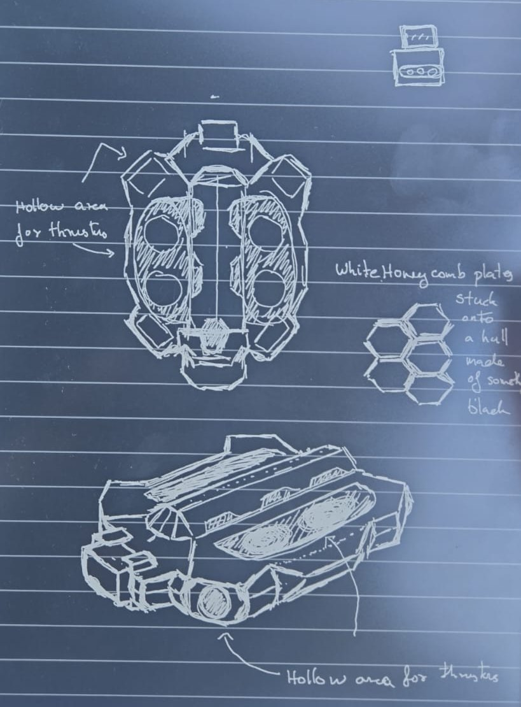</td>
    <td width="33%">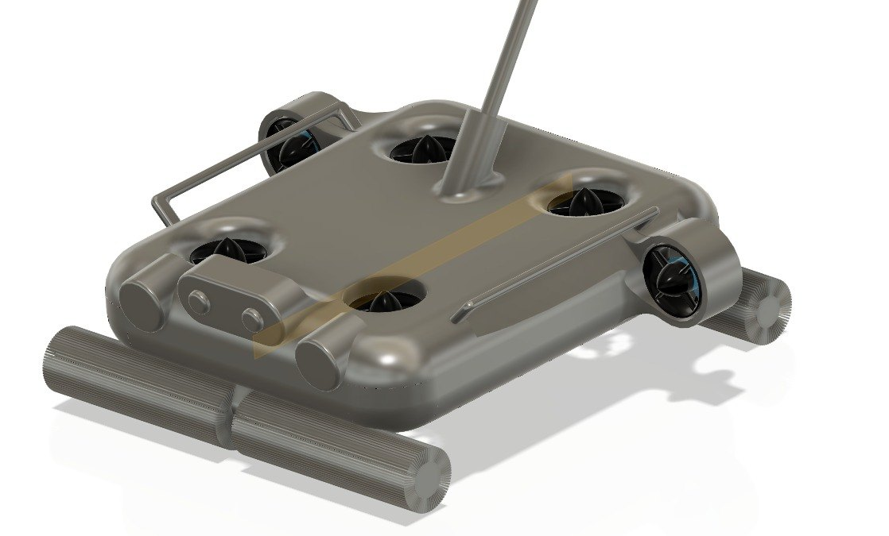</td>
    <td width="33%">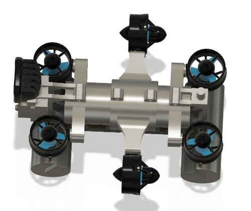</td>
  </tr>
  <tr>
    <td align="center"><b>1 · Sketches</b>: hull shape with recessed thruster bays</td>
    <td align="center"><b>2 · Initial concept</b>: low-profile body, thrusters set into the hull</td>
    <td align="center"><b>3 · Open frame</b>: central enclosure with outboard thrusters</td>
  </tr>
  <tr>
    <td width="33%">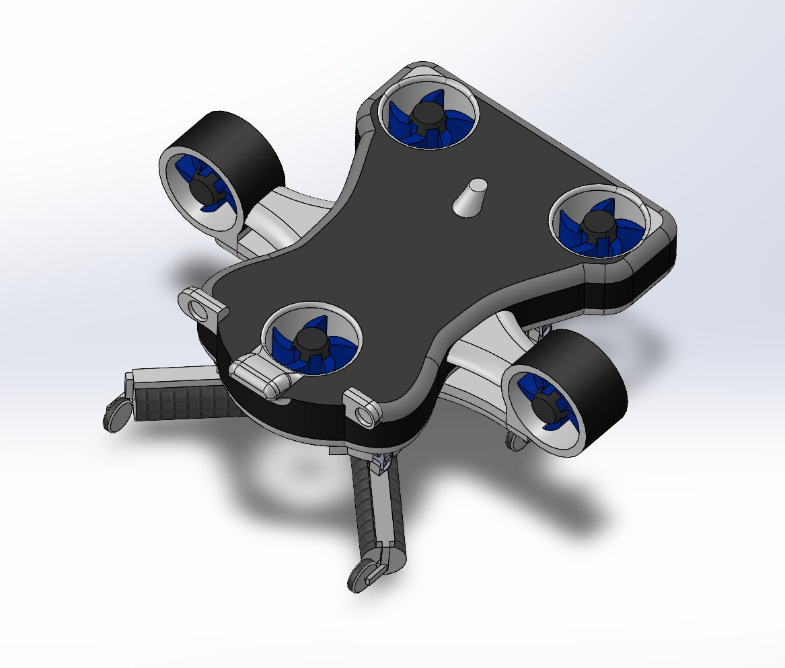</td>
    <td width="33%">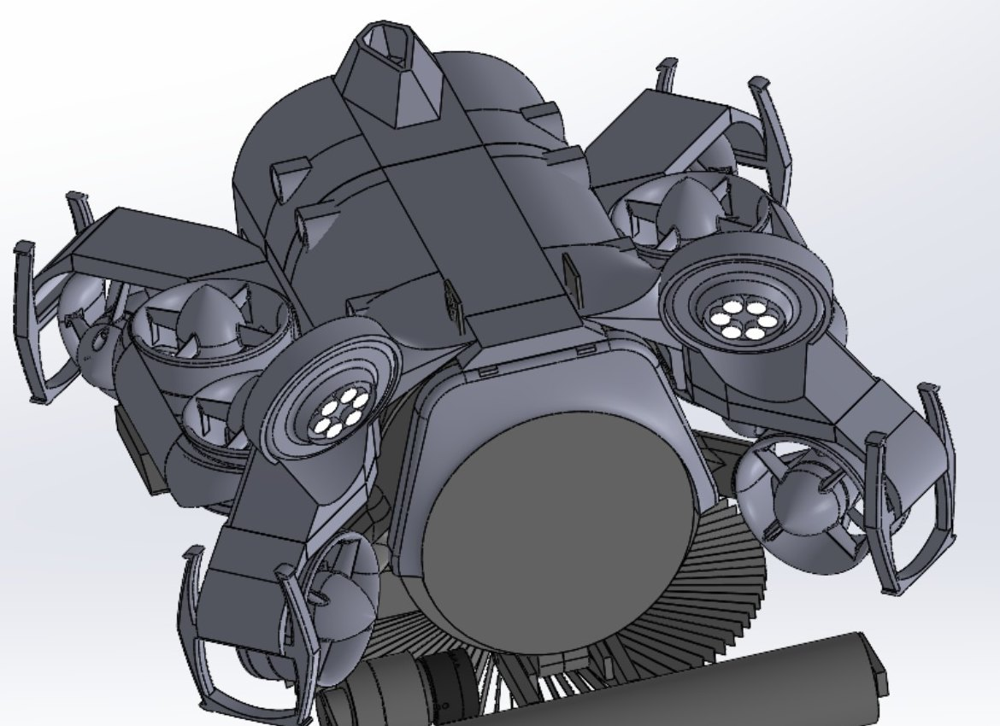</td>
    <td width="33%">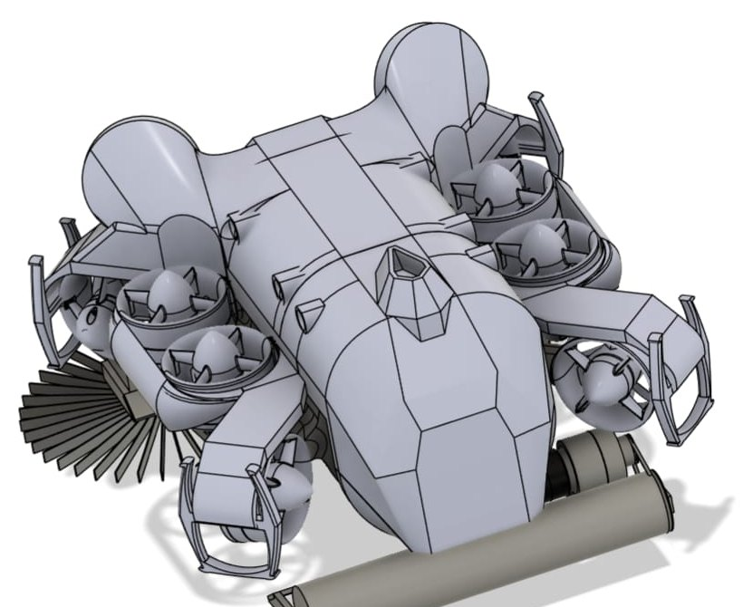</td>
  </tr>
  <tr>
    <td align="center"><b>4 · Concept V2</b>: shaped top cover over a thruster layout</td>
    <td align="center"><b>5 · Prototype 2</b>: thruster pods arranged around the enclosure</td>
    <td align="center"><b>6 · Prototype 2 cover</b>: hydrodynamic outer shell</td>
  </tr>
</table>

## V1 vehicle design

  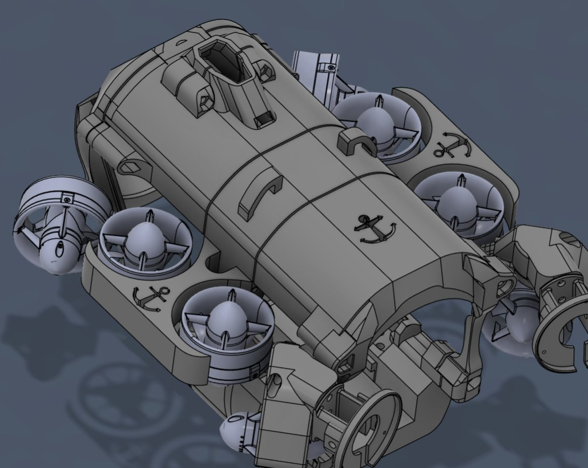

- **Structural layout:** thruster pods arranged around a central sealed electronics enclosure, with the frame carrying the load paths between them
- **Hydrodynamic outer cover:** engineered and tuned for **buoyancy control and alignment of the centre of buoyancy (CB) with the centre of gravity (CG)**, so the vehicle stays level and stable without constant correction from the thrusters
- **Thruster guards:** custom-designed guards that protect the propellers while keeping the flow path open

<table>
  <tr>
    <td width="50%">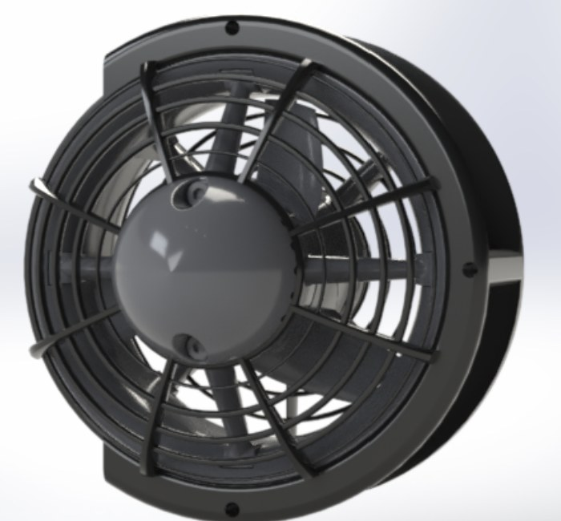</td>
    <td width="50%">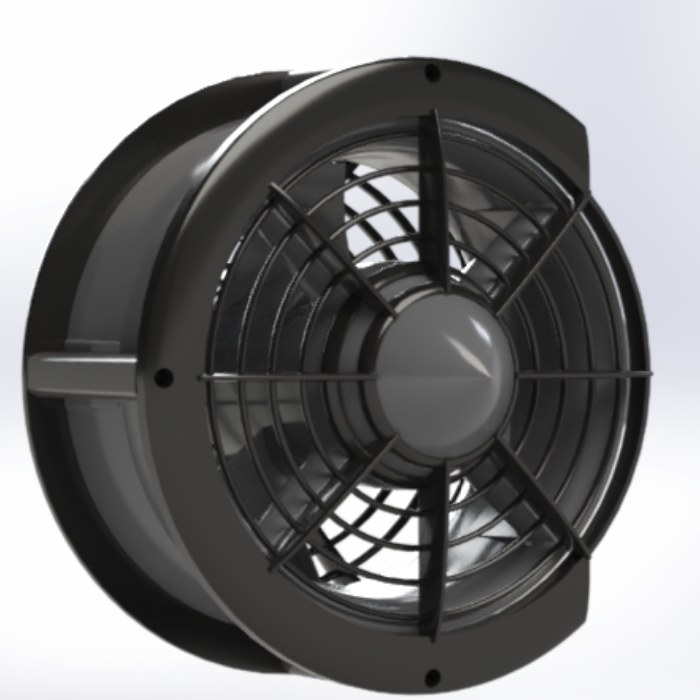</td>
  </tr>
</table>

## Flow simulation

I used flow simulation to check the thruster layout and the hydrodynamic loads on the structure
before committing to fabrication. Catching problems in simulation instead of in physical builds
is what made the faster iteration cycle possible.

  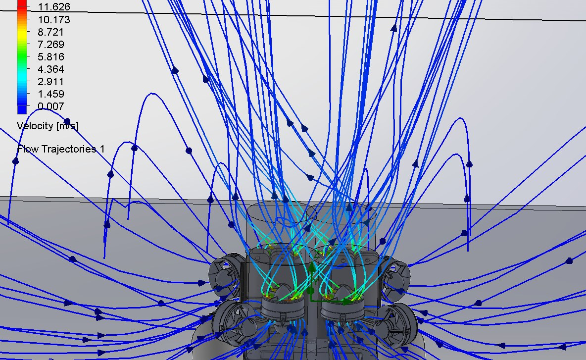
   Flow trajectories coloured by velocity (m/s), showing the thruster jets and the flow drawn in around the vehicle

## Electronics rail

The electronics sit on a custom **rail assembly that slides out of the sealed enclosure**. Every
board can be reached for service without taking the vehicle apart. The rail carries the
**Pixhawk-based flight controller**, which supports both manual and assisted operation, along with
the companion computer and power electronics.

<table>
  <tr>
    <td width="50%">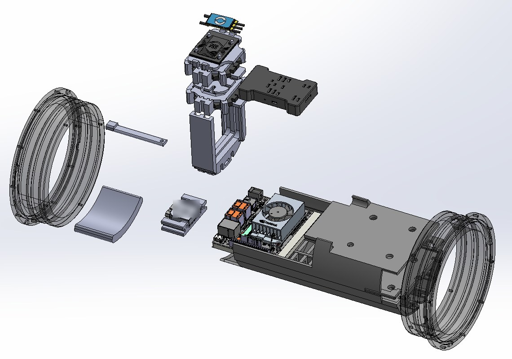</td>
    <td width="50%">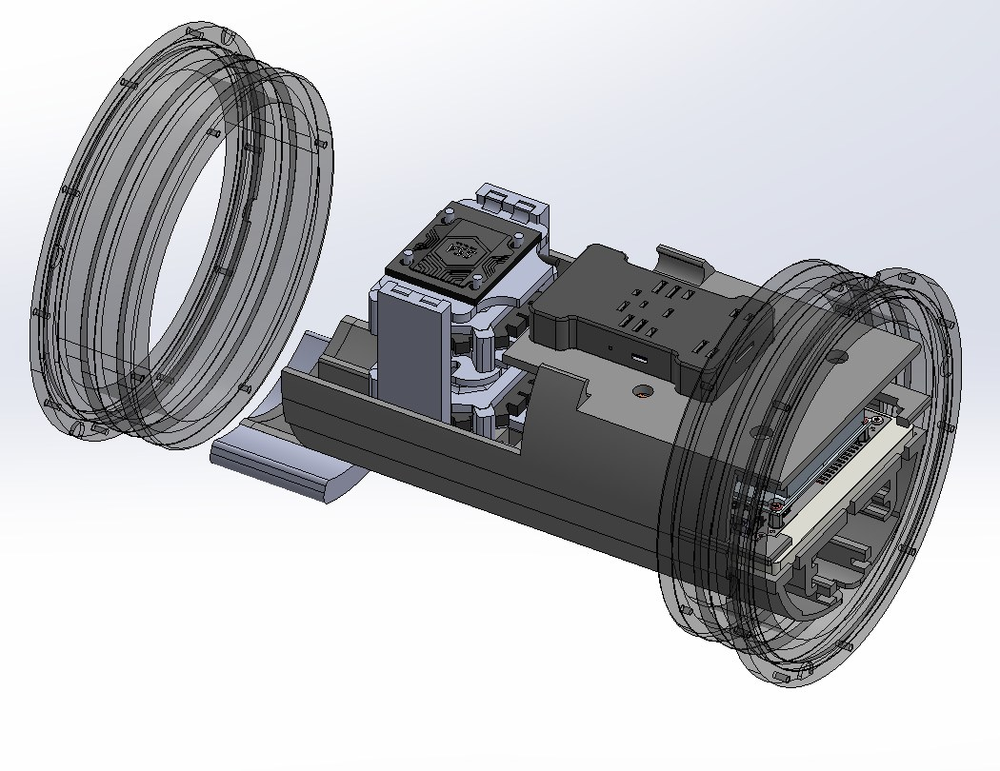</td>
  </tr>
  <tr>
    <td align="center">Exploded view: end caps, rail, controller stack, compute and power boards</td>
    <td align="center">Assembled rail sliding into the enclosure</td>
  </tr>
</table>

## Build and pool testing

  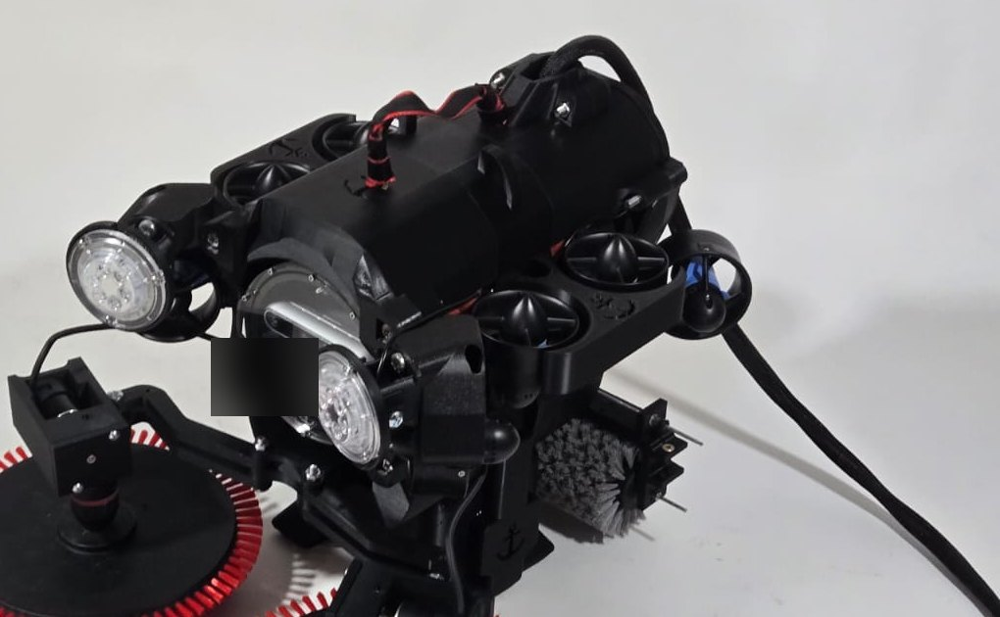

  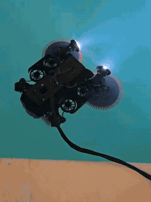
   V1 under tethered control during pool trials

## What I took away from it

- **Simulate before you print.** Moving checks into simulation shortened the loop between design reviews more than any other change.
- **Design for service.** A sealed enclosure is only practical if the electronics inside can be reached quickly. The slide-out rail solved that.
- **Mechanical design is a negotiation.** Sensor placement, cable routing and controller requirements all shaped the structure as much as the loads did.

## Tools

SolidWorks · Fusion 360 · SolidWorks Flow Simulation · structural FEA · Pixhawk · 3D printing
